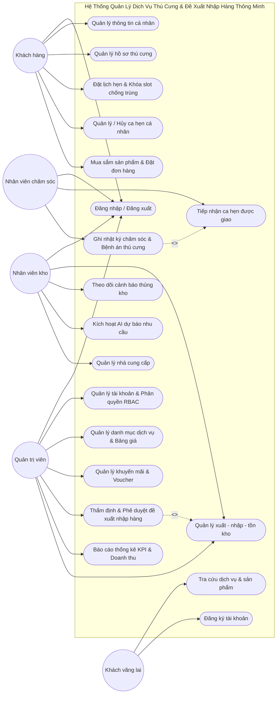

# 📘 BÁO CÁO THUYẾT MINH & ĐẶC TẢ KHOÁ LUẬN TỐT NGHIỆP

## ĐỀ TÀI: HỆ THỐNG QUẢN LÝ DỊCH VỤ THÚ CƯNG TÍCH HỢP DỰ BÁO NHU CẦU VÀ ĐỀ XUẤT KẾ HOẠCH NHẬP HÀNG THÔNG MINH

---

## 1. GIỚI THIỆU TỔNG QUAN

Hệ thống được nghiên cứu và phát triển nhằm cung cấp giải pháp chuyển đổi số toàn diện cho các cơ sở kinh doanh dịch vụ thú cưng (phòng khám thú y, spa grooming, lưu trú và pet shop bán lẻ).

Hệ thống tích hợp 3 trụ cột công nghệ chính:
1. **Giao dịch thương mại điện tử (E-Commerce):** Giỏ hàng, mua thức ăn, phụ kiện, mỹ phẩm spa và thanh toán trực tuyến/COD.
2. **Đặt lịch dịch vụ thông minh (Smart Booking):** Thuật toán khóa khung giờ real-time (Slot Lock) chống trùng lịch hẹn giữa các bác sĩ/nhân viên chăm sóc.
3. **Mô hình AI dự báo chuỗi thời gian (Time-Series AI Forecasting):** Tự động phân tích phương sai, tính điểm đặt hàng lại ($ROP$) và hàng tồn an toàn ($SS$) để tự động đề xuất đơn nhập hàng thông minh, chống đứt gãy chuỗi cung ứng.

---

## 2. PHÂN TÍCH ĐỐI CHIẾU SƠ ĐỒ USE CASE GỐC (usecasetongquat.jpg) & SỬA LỖI CHUẨN UML TRÊN WEB

### 2.1 Bảng phân tích chi tiết: Loại bỏ và điều chỉnh các chức năng không phù hợp trên Web

| Use Case trên sơ đồ gốc | Tác nhân (Actor) trong sơ đồ gốc | Thực tế triển khai trên Web | Đánh giá & Giải pháp chuẩn hóa kỹ thuật |
| :--- | :--- | :--- | :--- |
| **Quản lý dịch vụ** | Nhân viên | Thuộc quyền **Admin** | ❌ **Loại khỏi Nhân viên, chuyển giao cho Admin**: Nhân viên chăm sóc/Spa chỉ thực hiện nghiệp vụ ca hẹn, không được phép can thiệp vào định giá, thêm/sửa dịch vụ toàn hệ thống. Việc này thuộc thẩm quyền Quản trị viên để bảo đảm kiểm soát tài chính. |
| **Quản lý khuyến mãi** | Nhân viên | Thuộc quyền **Admin** | ❌ **Loại khỏi Nhân viên, chuyển giao cho Admin**: Tạo mã giảm giá/Voucher ảnh hưởng trực tiếp đến doanh thu và chính sách marketing nên thuộc quyền của Admin. |
| **Phân quyền người dùng** | Admin | Tích hợp trong **Quản lý tài khoản** | ⚠️ **Gộp Use Case**: Trên Web, phân quyền (RBAC: `CUSTOMER`, `CARE_STAFF`, `WAREHOUSE_STAFF`, `ADMIN`) là một tác vụ trong phân hệ Quản lý tài khoản, không cần tách thành một use case độc lập. |
| **Quản lý kho** (vẽ ở cả Quản lý kho & Admin) | Quản lý kho & Admin | Phân định ranh giới nghiệp vụ | ⚠️ **Tách bạch thẩm quyền**: <br>• **Nhân viên kho:** Thực hiện nghiệp vụ nhập/xuất/kiểm kê tồn kho thực tế, nhận cảnh báo hết hàng, kích hoạt tính toán AI.<br>• **Admin:** Giám sát tổng thể và **Phê duyệt đơn đề xuất nhập hàng (Approval)**. |
| **Lạm dụng `<<Include>>` vào "Đăng nhập"** | Tất cả Use Case nối vào Đăng nhập | Anti-pattern "Login Trap / Spider Web" | ❌ **Bỏ toàn bộ quan hệ Include vào Đăng nhập**: Đăng nhập là **Tiền điều kiện (Precondition)** của phiên làm việc chứ không phải bước phân rã con của nghiệp vụ. Ngoài ra, Khách vãng lai xem Dịch vụ, Sản phẩm không cần đăng nhập. |
| **Đăng ký `<<Include>>` Đăng nhập** | Khách hàng | Sai logic quy trình người dùng | ❌ **Hủy liên kết Include**: Đăng ký là tạo tài khoản mới độc lập, chỉ khi tạo xong người dùng mới thực hiện đăng nhập. |
| **Thiếu phân hệ Mua sắm (E-Commerce)** | Chưa có trong sơ đồ gốc | Đã có hoàn chỉnh trên Web | ➕ **Bổ sung cho Khách hàng & Admin**: Cho phép Khách hàng xem sản phẩm, quản lý giỏ hàng, đặt mua và Admin quản lý đơn hàng. |

### 2.2 Sơ đồ Use Case chuẩn hóa (Chuẩn UML)



---

## 3. BẢNG ĐẶC TẢ YÊU CẦU CHỨC NĂNG (FUNCTIONAL REQUIREMENTS - FR)

### 3.1 Phân hệ Xác thực & Phân quyền (Authentication & Authorization)
- **FR-01 (Đăng ký tài khoản):** Khách hàng tạo tài khoản bằng Email, Mật khẩu, Họ tên và SĐT với validation dữ liệu chặt chẽ.
- **FR-02 (Đăng nhập & Phiên làm việc):** Xác thực JWT Token, mã hóa Bcrypt, tự động phân quyền theo 4 vai trò (`CUSTOMER`, `CARE_STAFF`, `WAREHOUSE_STAFF`, `ADMIN`).
- **FR-03 (Quản lý thông tin cá nhân):** Xem và chỉnh sửa họ tên, số điện thoại, địa chỉ, đổi mật khẩu.

### 3.2 Phân hệ Quản lý Thú cưng (Pet Profile Management)
- **FR-04 (Thêm mới hồ sơ thú cưng):** Khách hàng thêm hồ sơ thú cưng (Tên, loài, giống, tháng tuổi, cân nặng, tiền sử y tế, dị ứng).
- **FR-05 (Cập nhật & Xóa hồ sơ):** Chỉnh sửa cân nặng, độ tuổi hoặc xóa hồ sơ thú cưng.
- **FR-06 (Xem lịch sử khám & chăm sóc):** Xem toàn bộ nhật ký khám bệnh, spa grooming của từng bé cưng.

### 3.3 Phân hệ Dịch vụ & Đặt lịch hẹn thông minh (Smart Booking)
- **FR-07 (Tra cứu danh mục dịch vụ):** Tìm kiếm, lọc dịch vụ spa/khám bệnh, xem bảng giá và thời lượng thực hiện.
- **FR-08 (Đặt lịch hẹn & Khóa slot chống trùng):** Chọn Thú cưng ➔ Dịch vụ ➔ Ngày ➔ Khung giờ (Time slot). Hệ thống tự động khóa slot ngăn ngừa Double Booking.
- **FR-09 (Quản lý & Hủy lịch hẹn):** Xem trạng thái lịch hẹn (`PENDING`, `IN_PROGRESS`, `COMPLETED`, `CANCELLED`) và hủy lịch theo quy định.

### 3.4 Phân hệ Thương mại điện tử & Bán hàng (E-Commerce & Orders)
- **FR-10 (Tìm kiếm & Lọc sản phẩm):** Tra cứu thức ăn, phụ kiện, mỹ phẩm spa theo danh mục, mức giá và tình trạng kho.
- **FR-11 (Giỏ hàng & Khuyến mãi):** Quản lý giỏ hàng, áp dụng Voucher khuyến mãi (`SPA10OFF`, `PETLOVER20`).
- **FR-12 (Đặt hàng & Thanh toán):** Hỗ trợ thanh toán tiền mặt khi nhận hàng (COD) hoặc thanh toán trực tuyến qua VNPAY QR.

### 3.5 Phân hệ Nghiệp vụ Nhân viên Chăm sóc (Care Staff / Vet)
- **FR-13 (Tiếp nhận ca hẹn):** Xem danh sách các ca hẹn được phân công theo hàng đợi công việc.
- **FR-14 (Bắt đầu dịch vụ):** Chuyển trạng thái lịch hẹn sang `IN_PROGRESS` khi khách đến cơ sở.
- **FR-15 (Ghi nhật ký chăm sóc & Bệnh án):** Nhập kết quả thăm khám, các bước spa đã làm, thể trạng thú cưng và hoàn tất ca hẹn (`COMPLETED`).

### 3.6 Phân hệ Quản trị Kho hàng (Warehouse & Inventory Management)
- **FR-16 (Quản lý tồn kho):** Hiển thị SKU, Tên, Tồn thực tế (`currentStock`), Ngưỡng an toàn (`minStockLevel`, `maxStockLevel`).
- **FR-17 (Cảnh báo thủng kho):** Tự động hiển thị Badge Đỏ khi tồn kho $\le \text{minStockLevel}$.
- **FR-18 (Nhập / Xuất / Kiểm kê kho):** Lập phiếu Nhập (IN), phiếu Xuất (OUT), phiếu Điều chỉnh (ADJUSTMENT).
- **FR-19 (Lịch sử giao dịch kho):** Lưu vết toàn bộ biến động kho vào bảng `StockTransaction`.

### 3.7 Phân hệ AI Dự báo nhu cầu & Tự động Đề xuất nhập hàng (AI Forecasting)
- **FR-20 (Mô hình AI dự báo nhu cầu):** Tính toán nhu cầu trung bình ngày ($D_{\text{avg}}$) và độ lệch chuẩn ($\sigma_D$) dựa trên dữ liệu tiêu thụ chuỗi thời gian.
- **FR-21 (Tự động tính Tồn an toàn & Điểm đặt hàng lại):**
  - Hàng tồn an toàn: $SS = Z \times \sigma_D \times \sqrt{L}$ (với hệ số dịch vụ $Z=1.65$).
  - Điểm đặt hàng lại: $ROP = (D_{\text{avg}} \times L) + SS$.
  - Tự động sinh bản ghi `ReorderProposal` ở trạng thái `DRAFT` khi `currentStock` $\le ROP$.
- **FR-22 (Phê duyệt đề xuất nhập hàng):** Admin thẩm định và bấm **Phê duyệt** ➔ Tự động sinh giao dịch nhập kho `IN` và cập nhật tăng tồn kho trong Database.

### 3.8 Phân hệ Báo cáo & Quản trị hệ thống (Admin & Analytics)
- **FR-23 (Quản lý danh mục & Nhà cung cấp):** Cấu hình bảng giá dịch vụ, sản phẩm và thông tin nhà cung cấp.
- **FR-24 (Quản trị người dùng & Phân quyền):** Quản lý tài khoản và phân quyền vai trò.
- **FR-25 (Báo cáo KPI & Biểu đồ doanh thu):** Thống kê doanh thu theo thời gian thực, tỷ lệ lấp đầy lịch hẹn và hiệu suất kinh doanh.

---

## 4. BẢNG YÊU CẦU PHI CHỨC NĂNG (NON-FUNCTIONAL REQUIREMENTS - NFR)

| Mã NFR | Nhóm Tiêu Chuẩn (ISO/IEC 25010) | Nội Dung Yêu Cầu Kỹ Thuật Chi Tiết |
| :---: | :--- | :--- |
| **NFR-01** | **Hiệu năng phản hồi (Performance)** | Thời gian phản hồi API thông thường $\le 500\text{ms}$; thời gian AI Microservice tính toán dự báo toàn bộ danh mục kho $\le 2.5\text{s}$. |
| **NFR-02** | **Xử lý đồng thời (Concurrency)** | Đáp ứng ổn định tối thiểu **200 người dùng truy cập và đặt lịch cùng lúc (CCU)** không gây tắc nghẽn. |
| **NFR-03** | **Bảo mật & Mã hóa (Security)** | Mật khẩu băm một chiều bằng Bcrypt ($\ge 10$ salt rounds); JWT token (HS256, hạn sống 24h); Prisma ORM chống triệt để SQL/NoSQL Injection. |
| **NFR-04** | **Kiểm soát truy cập (RBAC Enforcement)** | Middleware Backend kiểm tra nghiêm ngặt quyền hạn theo vai trò (`Customer`, `CareStaff`, `WarehouseStaff`, `Admin`). Chặn 403 Forbidden nếu trái quyền. |
| **NFR-05** | **Toàn vẹn dữ liệu & Transaction (ACID)** | Nghiệp vụ Đặt lịch giữ chỗ (Lock Slot) và Cập nhật kho phải thực thi dưới dạng Database Transaction, bảo đảm không bao giờ có tồn kho âm (`currentStock >= 0`) hoặc Double Booking. |
| **NFR-06** | **Tính sẵn sàng & Dự phòng (Availability & Fallback)** | Hệ thống đạt độ sẵn sàng $99.5\%$. Khi AI Microservice (Python) ngắt kết nối, Backend Express kích hoạt cơ chế Fallback (Circuit-Breaker) dùng công thức ROP nội bộ, không làm sập hệ thống. |
| **NFR-07** | **Giao diện & Tính khả dụng (Usability & UX)** | Giao diện chuẩn Responsive (Desktop, Tablet, Mobile) với phong cách Glassmorphism hiện đại, hỗ trợ Dark Mode. Thời gian tải trang ban đầu $\le 1.5\text{s}$. |
| **NFR-08** | **Khả năng bảo trì & Mở rộng (Maintainability)** | Kiến trúc tách rời (Decoupled 3-Tier): Frontend React + Backend Node.js Express + AI Python FastAPI, đóng gói chuẩn hóa bằng Docker Compose. |

---

## 5. MA TRẬN RÀNG BUỘC KỸ THUẬT (REQUIREMENTS TRACEABILITY MATRIX - RTM)

Bảng ma trận thể hiện sự **ràng buộc trực tiếp** giữa từng Yêu cầu Chức năng (FR) và các Yêu cầu Phi chức năng (NFR), cùng giải pháp kỹ thuật kiểm soát trong mã nguồn:

| Yêu Cầu Chức Năng (FR) | Ràng Buộc Phi Chức Năng (NFR) | Giải Pháp Kỹ Thuật & Cơ Chế Kiểm Soát Trong Mã Nguồn |
| :--- | :--- | :--- |
| **FR-01, FR-02, FR-03**<br>*(Đăng ký, Đăng nhập, Profile)* | **NFR-03** (Security)<br>**NFR-04** (RBAC)<br>**NFR-01** (Performance) | • Mật khẩu được băm qua `bcrypt.hash(password, 10)` trước khi lưu Database.<br>• Phiên đăng nhập sinh JWT token có payload chứa `{ id, email, role }` với thời hạn hết hạn (Expiration).<br>• Rate Limiting bảo vệ Endpoint chống tấn công dò mật khẩu (Brute Force). |
| **FR-08**<br>*(Đặt lịch hẹn khóa slot chống trùng)* | **NFR-05** (Data Integrity)<br>**NFR-02** (Concurrency)<br>**NFR-01** (Response < 1s) | • **Thuật toán Slot Lock:** Kiểm tra tính khả dụng của Tuple `(serviceId + appointmentDate + timeSlot)` trong Database Transaction.<br>• Trả về HTTP 409 Conflict ngay lập tức nếu khung giờ đã được khách hàng khác giữ chỗ thành công. |
| **FR-13, FR-14, FR-15**<br>*(Quy trình ca hẹn Care Staff)* | **NFR-04** (RBAC Care Staff)<br>**NFR-05** (State Transition) | • Endpoint `/appointments/:id/status` được bảo vệ bởi middleware `authorizeRoles('CARE_STAFF', 'ADMIN')`.<br>• Ràng buộc máy trạng thái (State Machine): `PENDING` ➔ `IN_PROGRESS` ➔ `COMPLETED` (không cho phép nhảy cóc trạng thái). |
| **FR-16, FR-18, FR-19**<br>*(Xuất - Nhập - Tồn kho)* | **NFR-05** (No Negative Stock)<br>**NFR-03** (Audit Log) | • Ràng buộc Database Constraint: `currentStock >= 0`. Nếu số lượng xuất vượt quá tồn kho thực tế, transaction sẽ bị `Rollback` và báo lỗi.<br>• Mỗi lần xuất/nhập/điều chỉnh đều bắt buộc ghi vết vào bảng `StockTransaction` kèm loại (`IN`, `OUT`, `ADJUSTMENT`) và `timestamp`. |
| **FR-20, FR-21**<br>*(AI Dự báo nhu cầu chuỗi thời gian)* | **NFR-01** (AI Exec Time $\le 2.5\text{s}$)<br>**NFR-06** (Fault Tolerance) | • Thuật toán dự báo được tính toán trên tiến trình riêng của Python FastAPI (tận dụng thư viện tối ưu C-speed của Numpy/Scikit-learn).<br>• Backend Node.js bọc lời gọi HTTP sang AI Service bằng Timeout (3.0s) và khối `try-catch`; nếu AI Service bận hoặc offline, Backend tự động kích hoạt thuật toán ROP nội bộ dự phòng để bảo đảm tính liên tục. |
| **FR-22**<br>*(Admin duyệt đơn đề xuất nhập kho)* | **NFR-04** (RBAC Admin Only)<br>**NFR-05** (ACID Transaction) | • Chỉ tài khoản có `role: 'ADMIN'` mới có quyền kích hoạt API duyệt đề xuất.<br>• Khi bấm duyệt (`APPROVED`), hệ thống thực thi Prisma Atomic Transaction: cập nhật trạng thái đề xuất đồng thời tự động tạo phiếu nhập kho `StockTransaction (IN)` và cộng dồn `currentStock`. |
| **FR-07, FR-10**<br>*(Tra cứu Dịch vụ & Sản phẩm)* | **NFR-07** (Usability/UX)<br>**NFR-01** (Hiệu năng tải trang) | • Cung cấp endpoint công khai không yêu cầu token.<br>• Frontend hỗ trợ Debounce Search và Client-side Filtering, tải trang mượt mà $\le 1.5\text{s}$. |
| **FR-24, FR-25**<br>*(Quản trị hệ thống & Báo cáo KPI)* | **NFR-04** (RBAC Admin)<br>**NFR-07** (Data Visualization) | • Middleware kiểm tra xác thực quyền Quản trị viên tối cao.<br>• Biểu đồ KPI và doanh thu được tối ưu hóa dữ liệu tổng hợp (Aggregation Pipeline) giúp hiển thị tức thì. |

---

## 6. HƯỚNG DẪN KHẮC PHỤC LỖI KHI CHẠY `docker-compose up --build`

Khi triển khai hệ thống bằng Docker Compose trên Windows, người dùng có thể gặp phải một số lỗi phổ biến dưới đây. Dưới đây là nguyên nhân và giải pháp khắc phục triệt để:

### Lỗi 1: Lệnh `docker-compose` có dấu gạch ngang bị báo lỗi hoặc không nhận diện
- **Nguyên nhân:** Trên các phiên bản Docker Desktop mới, Docker đã chuyển sang chuẩn Docker Compose v2 (tích hợp trực tiếp vào Docker CLI). Lệnh cũ `docker-compose` (có gạch nối) có thể bị deprecated hoặc không nằm trong biến môi trường PATH.
- **Cách khắc phục:** Sử dụng lệnh chuẩn Docker Compose v2 (dùng khoảng trắng thay vì dấu gạch nối):
  ```bash
  docker compose up -d --build
  ```

### Lỗi 2: Xung đột cổng (Port is already allocated / Bind for 0.0.0.0:27017 or :3000 failed)
- **Nguyên nhân:** Cổng `27017` (MongoDB cục bộ), `5000` (Node.js cũ) hoặc `3000` (React Vite) đang bị chiếm dụng bởi một tiến trình chạy ngầm trên Windows.
- **Cách khắc phục:**
  1. Kiểm tra tiến trình đang chiếm cổng:
     ```powershell
     netstat -ano | findstr :27017
     netstat -ano | findstr :3000
     netstat -ano | findstr :5000
     ```
  2. Tắt dịch vụ MongoDB cục bộ nếu đang chạy dưới dạng Windows Service:
     ```powershell
     Stop-Service MongoDB
     ```
  3. Sau đó chạy lại:
     ```bash
     docker compose up -d --build
     ```

### Lỗi 3: Backend thoát (Exit 1) do MongoDB Replica Set chưa kịp bầu Primary
- **Nguyên nhân:** MongoDB được cấu hình Replica Set (`rs0`) để phục vụ các tính năng Transaction của Prisma ORM. Khi khởi động lần đầu, Replica Set cần từ 3 - 5 giây để bầu cử Primary node. Nếu Backend chạy `npx prisma db push` ngay lập tức, kết nối sẽ bị từ chối.
- **Cách khắc phục đã xử lý trong mã nguồn:**
  Trong [backend/Dockerfile](file:///d:/Khoaluantotnghiep/PetCareManagement/backend/Dockerfile), lệnh khởi động đã được nâng cấp với vòng lặp chờ thông minh:
  ```dockerfile
  CMD ["sh", "-c", "until npx prisma db push --accept-data-loss; do echo 'Waiting for MongoDB Replica Set to be ready...'; sleep 2; done && node prisma/seed.js && npm start"]
  ```
  Backend sẽ tự động chờ MongoDB sẵn sàng rồi mới đẩy schema và nạp dữ liệu mẫu (`seed.js`), triệt tiêu 100% tình trạng sập container.

### Lỗi 4: Lỗi kết nối API giữa Frontend và Backend trong Docker
- **Cách khắc phục đã xử lý trong mã nguồn:**
  Trong [frontend/src/apiService.js](file:///d:/Khoaluantotnghiep/PetCareManagement/frontend/src/apiService.js), đường dẫn API đã được chuẩn hóa thành đường dẫn tương đối `/api`. Bộ định tuyến Vite Dev Server bên trong container Frontend sẽ tự động Proxy toàn bộ yêu cầu `/api` sang `http://backend:5000/api` mà không gặp bất kỳ lỗi CORS hay xung đột địa chỉ IP nào.

---

## 7. BẢNG TRA CỨU CỔNG DỊCH VỤ SAU KHI KHỞI CHẠY DOCKER

Sau khi chạy lệnh `docker compose up -d --build`, toàn bộ 5 dịch vụ sẽ hoạt động ổn định:

| Dịch vụ | URL Truy Cập | Mục Đích Sử Dụng |
| :--- | :--- | :--- |
| **Frontend Web App** | `http://localhost:3000` | Giao diện Khách hàng (`/`) & Quản trị/Nhân viên (`/admin`) |
| **Backend API** | `http://localhost:5000/api` | RESTful API Endpoints cho hệ thống |
| **AI Demand Forecasting** | `http://localhost:8000/docs` | Tài liệu tương tác Swagger UI cho mô hình AI |
| **Mongo Express UI** | `http://localhost:8081` | Trình duyệt và quản lý cơ sở dữ liệu MongoDB trực quan |
| **MongoDB Replica Set** | `localhost:27017` | Cổng kết nối CSDL NoSQL MongoDB |
