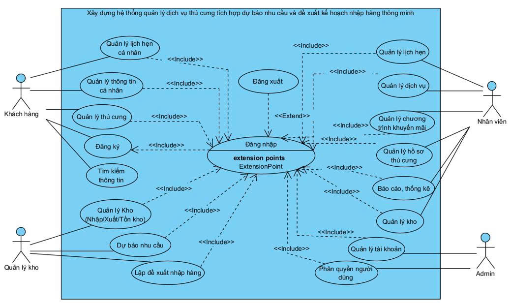

# 🐾 PETZERA — Hệ Thống Quản Lý Dịch Vụ Thú Cưng, Pet Shop & Dự Báo Kho AI

> **Đồ Án Khóa Luận Tốt Nghiệp** — Nền tảng chăm sóc thú cưng toàn diện kết hợp **Cổng Khách Hàng E-Commerce & Đặt Lịch Thông Minh** với **Hệ Thống Quản Trị Nội Bộ Phân Quyền RBAC** và **Microservice AI Dự Báo Nhu Cầu Nhập Hàng**.


-2496ED?style=flat-square&logo=docker)

---

## ✨ Tính Năng Nổi Bật

### 1. Cổng Khách Hàng — Petzera Flagship Storefront (`/`)
- **Nhận diện thương hiệu & Trang chủ Cinema Video:**
  - Bộ logo vector độc quyền **`PETZERA`** ([BrandLogo.jsx](frontend/src/components/BrandLogo.jsx)) đồng bộ trên Header, Footer, màn hình đăng nhập, Favicon và PWA Manifest.
  - Màn hình **Intro mở màn**, sân khấu **Hero Video toàn khung** tự động phát luân phiên 3 Reel HD thú cưng (*Spa & Tắm Sấy 5★*, *Chăm Sóc Cún Cưng*, *Thế Giới Mèo Cưng*), hiệu ứng **Parallax 3D theo chuột**, dải chữ chạy **Marquee**, bộ sưu tập **Video Reels Lookbook** (xem toàn màn hình Lightbox) và hiệu ứng cuộn trang **Scroll-Reveal**.
- **Khoa Sinh Sản & Hộ Sinh Thú Cưng 24/7 (`/khoa-sinh-san`):**
  - Giới thiệu chuyên khoa tiêu chuẩn VPet's: Siêu âm Doppler, đỡ đẻ & mổ đẻ vô trùng C-Section, triệt sản Minilap thẩm mỹ.
  - Tích hợp **Công cụ tính ngày dự sinh tự động** cho Chó & Mèo kèm mốc thăm khám khuyến nghị.
- **Dịch Vụ Spa, Khách Sạn VIP & Khám Thú Y (`/dich-vu-spa`, `/dich-vu/:id`):**
  - 20 dịch vụ niêm yết giá công khai phân theo 5 chuyên mục, có **trang chi tiết dịch vụ riêng** và hệ thống **đặt lịch khóa trùng khung giờ (slot) real-time**.
- **Cửa Hàng Pet Shop E-Commerce (`/cua-hang`, `/san-pham/:id`, `/gio-hang`, `/thanh-toan`):**
  - Danh mục **44+ sản phẩm chính hãng** (Royal Canin, ANF 6 Free, Dr. Kyan, Orijen, Flexi, Inaba Ciao, Frontline Plus...) có bộ lọc danh mục, tìm kiếm, sắp xếp giá và **trang chi tiết sản phẩm riêng**.
  - **Trang giỏ hàng riêng (`/gio-hang`)** và **quy trình thanh toán 3 bước (`/thanh-toan`)**: hỗ trợ giao hàng tiêu chuẩn/hỏa tốc 2H, mã giảm giá (`SPA10OFF`, `PETLOVER20`), thanh toán **COD**, **VietQR tự động tạo mã chuyển khoản** và **Ví MoMo/ZaloPay**, xuất **hóa đơn xác nhận đơn hàng**.
- **Quản Lý Hồ Sơ Thú Cưng & Tiến Độ (`/thu-cung`, `/lich-hen`):**
  - Đăng ký / đăng nhập linh hoạt bằng **Email hoặc Số điện thoại**, lưu hồ sơ sức khỏe thú cưng, theo dõi trạng thái ca hẹn & nhật ký chăm sóc trực tiếp, hỗ trợ hủy lịch giải phóng slot.
- **Tối Ưu SEO Kỹ Thuật & On-Page:**
  - Đường dẫn sạch chuẩn REST/SEO qua History API, cấu hình `robots.txt`, `sitemap.xml`, `site.webmanifest`, thẻ Open Graph / Twitter Card và dữ liệu có cấu trúc **JSON-LD** (`VeterinaryCare`, `PetStore`, `Product`, `Service`) cập nhật động theo từng trang qua `seoManager.js`.

### 2. Hệ Thống Quản Trị Nội Bộ Phân Quyền RBAC (`/admin`)
Thiết kế bám sát **1-1 theo Sơ đồ Use Case tổng quát** với 3 vai trò tách biệt nghiệp vụ (Segregation of Duties):

- **👨‍⚕️ Nhân Viên Chăm Sóc (`CARE_STAFF`) — 6 phân hệ:**
  - Tiếp nhận & điều phối lịch hẹn, quản lý danh mục dịch vụ, chương trình khuyến mãi, quản lý hồ sơ thú cưng & ghi nhật ký chăm sóc, báo cáo thống kê cá nhân và tra cứu tồn kho.
- **📦 Quản Lý Kho (`WAREHOUSE_STAFF`) — 3 phân hệ:**
  - Quản lý Nhập/Xuất/Tồn kho & cảnh báo sắp hết hàng, chạy **Dự báo nhu cầu AI** kết nối Python FastAPI Microservice, và **lập đề xuất nhập hàng** gửi sang trạng thái *Chờ Admin phê duyệt*.
- **🛡️ Quản Trị Viên (`ADMIN`) — 6 phân hệ:**
  - Dashboard tổng quan KPI & xuất báo cáo CSV, quản lý tài khoản người dùng, ma trận phân quyền RBAC, **phê duyệt / từ chối đề xuất nhập hàng**, quản lý nhà cung cấp, cấu hình hệ thống & nhật ký kiểm toán (**Audit Logs**).

---

## 🗺️ Sơ Đồ Use Case Tổng Quát



---

## 🛠️ Kiến Trúc Công Nghệ (Tech Stack)

| Tầng Hệ Thống | Công Nghệ Sử Dụng | Vai Trò Chính |
| :--- | :--- | :--- |
| **Frontend** | React 18, Vite 5, Vanilla CSS, Lucide Icons | Giao diện Khách hàng, Cinema Video Hero, SEO động & 3 Dashboard nội bộ |
| **Backend API** | Node.js, Express.js, Prisma ORM v5, JWT, Bcryptjs | Kiến trúc 3 lớp (`Controller → Service → Prisma`), xác thực & phân quyền RBAC |
| **Database** | MongoDB 7.0 (Replica Set) + Mongo Express | Lưu trữ NoSQL cho người dùng, thú cưng, dịch vụ, lịch hẹn, sản phẩm, đơn hàng & kho |
| **AI Microservice** | Python, FastAPI, Uvicorn, Pandas, NumPy, Scikit-Learn | Dự báo nhu cầu tiêu thụ theo chuỗi thời gian, tính tồn kho an toàn & gợi ý nhập hàng |
| **DevOps** | Docker & Docker Compose | Điều phối đồng bộ 5 container chỉ bằng một câu lệnh |

---

## 📁 Cấu Trúc Thư Mục Dự Án

```text
PetCareManagement/
├── docker-compose.yml              # Điều phối 5 containers (Mongo, Mongo-Express, AI, Backend, Frontend)
├── usecasetongquat.jpg             # Sơ đồ Use Case tổng quát hệ thống
├── README.md
│
├── frontend/                       # ReactJS + Vite SPA (Cổng Khách Hàng & Quản Trị)
│   ├── Dockerfile
│   ├── index.html                  # Meta SEO, JSON-LD tổ chức & Favicon vector Petzera
│   ├── public/
│   │   ├── robots.txt
│   │   ├── sitemap.xml
│   │   └── site.webmanifest
│   ├── src/
│   │   ├── components/
│   │   │   ├── BrandLogo.jsx             # Logo thương hiệu vector PETZERA
│   │   │   ├── Navbar.jsx                # Thanh điều hướng & giỏ hàng
│   │   │   ├── Sidebar.jsx               # Menu phân quyền nội bộ (1-1 Use Case)
│   │   │   ├── HomeLandingPage.jsx       # Trang chủ Cinema Video, Splash Intro & Motion Effects
│   │   │   ├── CustomerPortal.jsx        # Shop, Chi tiết SP/DV, Giỏ hàng, Thanh toán, Thú cưng, Lịch hẹn
│   │   │   ├── ReproductionClinic.jsx    # Khoa Sinh Sản 24/7 & Máy tính ngày dự sinh
│   │   │   ├── CareStaffDashboard.jsx    # Cổng Nhân Viên Chăm Sóc
│   │   │   ├── WarehouseDashboard.jsx    # Cổng Quản Lý Kho & Dự báo AI
│   │   │   ├── AdminDashboard.jsx        # Cổng Quản Trị Viên & Phê duyệt nhập hàng
│   │   │   ├── LoginModal.jsx            # Đăng nhập / Đăng ký khách hàng (Email & SĐT)
│   │   │   ├── StaffLoginModal.jsx       # Cổng đăng nhập nội bộ RBAC
│   │   │   ├── FloatingContactWidget.jsx # Hotline, Zalo QR & Facebook Messenger
│   │   │   └── ToastNotification.jsx     # Hệ thống thông báo & hộp thoại xác nhận
│   │   ├── App.jsx                 # Clean URL routing & đồng bộ trạng thái ứng dụng
│   │   ├── apiService.js           # Giao tiếp REST API với Backend
│   │   ├── seoManager.js           # Quản lý Title, Meta & JSON-LD động theo từng trang
│   │   ├── mediaAssets.js          # Thư viện ảnh & video HD thú cưng, dịch vụ, 44+ sản phẩm
│   │   ├── mockData.js             # Dữ liệu khởi tạo chuẩn (20 dịch vụ, 44+ sản phẩm, mẫu đơn)
│   │   ├── contactConfig.js        # Cấu hình thông tin liên hệ Hotline / Zalo / Facebook
│   │   └── index.css               # Hệ thống giao diện Light Theme & Animation CSS
│   ├── vite.config.js
│   └── package.json
│
├── backend/                        # Node.js + Express + Prisma API Server
│   ├── Dockerfile
│   ├── prisma/
│   │   ├── schema.prisma           # Lược đồ dữ liệu MongoDB (Prisma Models)
│   │   └── seed.js                 # Khởi tạo dữ liệu mẫu vào MongoDB
│   ├── src/
│   │   ├── config/prisma.js
│   │   ├── controllers/            # auth, pet, appointment, inventory, order, forecasting
│   │   ├── services/               # Tầng xử lý nghiệp vụ tương ứng
│   │   ├── middleware/auth.js      # Xác thực JWT & kiểm soát quyền RBAC
│   │   ├── routes/api.js           # Định tuyến RESTful API
│   │   └── server.js
│   └── package.json
│
└── ai-service/                     # Python FastAPI Microservice Dự Báo Kho
    ├── Dockerfile
    ├── main.py                     # API dự báo nhu cầu & tính điểm đặt hàng lại (Reorder Point)
    └── requirements.txt
```

---

## 🐳 Khởi Chạy Bằng Docker Compose (Khuyên Dùng)

Khởi chạy toàn bộ 5 container bằng một câu lệnh duy nhất tại thư mục gốc:

```bash
docker compose up -d --build
```
*(Nếu máy cài bản cũ, dùng `docker-compose up -d --build`)*

| Dịch Vụ | Địa Chỉ Truy Cập | Mô Tả |
| :--- | :--- | :--- |
| **Frontend Web App** | `http://localhost:3000` | Trang chủ Petzera, Pet Shop, Đặt lịch & Cổng Quản Trị (`/admin`) |
| **Backend REST API** | `http://localhost:5000/api` | API nghiệp vụ Node.js + Express + Prisma |
| **AI Service Docs (Swagger)** | `http://localhost:8000/docs` | Tài liệu Swagger kiểm thử API dự báo nhu cầu FastAPI |
| **Mongo Express** | `http://localhost:8081` | Giao diện web quản lý trực quan dữ liệu MongoDB |
| **MongoDB Server** | `localhost:27017` | Cơ sở dữ liệu MongoDB 7.0 (Replica Set `rs0`) |

---

## 💻 Khởi Chạy Thủ Công (Local Development)

### 1. Backend API (Node.js + Prisma + MongoDB)
Đảm bảo MongoDB đang chạy ở cổng `27017` (Replica Set) và cấu hình biến môi trường trong `backend/.env`:

```bash
cd backend
npm install
npx prisma generate
npx prisma db push
npm run seed
npm run dev
# Chạy tại http://localhost:5000
```

### 2. AI Microservice (Python FastAPI)
```bash
cd ai-service
pip install -r requirements.txt
python main.py
# Chạy tại http://localhost:8000
```

### 3. Frontend (React + Vite)
```bash
cd frontend
npm install
npm run dev
# Chạy tại http://localhost:3000
```

*(Tùy chọn: chạy đồng thời 3 cổng Khách hàng `3000`, Admin `3001`, Nhân viên `3002` bằng `npm run dev:all`)*

---

## 🔗 Các Đường Dẫn Chính (Clean Routes)

| Đường Dẫn | Trang / Chức Năng |
| :--- | :--- |
| `/` | Trang chủ Petzera (Cinema Video Hero, Video Reels, Dịch vụ & Sản phẩm nổi bật) |
| `/khoa-sinh-san` | Khoa Sinh Sản 24/7 & Công cụ tính ngày dự sinh Chó/Mèo |
| `/dich-vu-spa` & `/dich-vu/:id` | Danh sách 20 dịch vụ Spa/Thú y & Trang chi tiết từng dịch vụ |
| `/cua-hang` & `/san-pham/:id` | Cửa hàng Pet Shop 44+ sản phẩm & Trang chi tiết từng sản phẩm |
| `/gio-hang` | Trang giỏ hàng riêng (tăng/giảm số lượng, áp mã khuyến mãi) |
| `/thanh-toan` | Trang thanh toán 3 bước (COD, VietQR, MoMo/ZaloPay & Hóa đơn xác nhận) |
| `/thu-cung` & `/lich-hen` | Hồ sơ thú cưng & Theo dõi tiến độ dịch vụ / lịch sử mua hàng |
| `/admin` | Cổng đăng nhập & làm việc nội bộ (Admin, Nhân viên Chăm sóc, Quản lý kho) |

---

## 🔑 Tài Khoản Mẫu & Mã Khuyến Mãi Kiểm Thử

- **Cổng Khách Hàng (`/`):** Nhấn **Đăng Nhập** trên thanh Header (hỗ trợ đăng nhập bằng Email hoặc Số điện thoại).
- **Cổng Nội Bộ (`/admin`):** Truy cập trực tiếp `http://localhost:3000/admin` hoặc bấm liên kết **🔒 Dành Cho Nhân Viên & Quản Trị** ở chân trang.

| Vai Trò (Role) | Tài Khoản Email | Mật Khẩu | Quyền Hạn Chính |
| :--- | :--- | :--- | :--- |
| **Quản Trị Viên (`ADMIN`)** | `admin@petcare.com` | `123456` | KPI tổng quan, quản lý tài khoản, RBAC, **duyệt đề xuất nhập hàng**, nhà cung cấp & Audit Logs |
| **Nhân Viên Chăm Sóc (`CARE_STAFF`)** | `care@petcare.com` | `123456` | Điều phối lịch hẹn, dịch vụ, khuyến mãi, hồ sơ thú cưng & nhật ký chăm sóc |
| **Quản Lý Kho (`WAREHOUSE_STAFF`)** | `warehouse@petcare.com` | `123456` | Nhập/Xuất/Tồn kho, chạy **dự báo AI**, lập đề xuất nhập hàng gửi Admin duyệt |
| **Khách Hàng (`CUSTOMER`)** | `khachhang@gmail.com` | `123456` | Tạo hồ sơ thú cưng, đặt lịch Spa/Khám, mua hàng & theo dõi đơn hàng |

**Mã khuyến mãi dùng thử tại Giỏ hàng / Thanh toán:**
- `SPA10OFF` — Giảm **10%** tổng giá trị đơn hàng.
- `PETLOVER20` — Giảm **20%** tổng giá trị đơn hàng.
